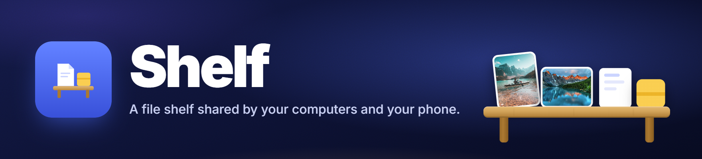
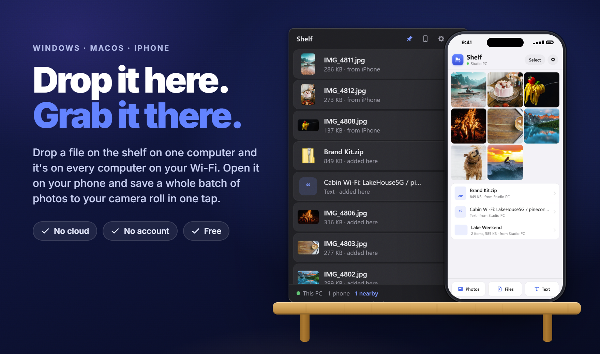
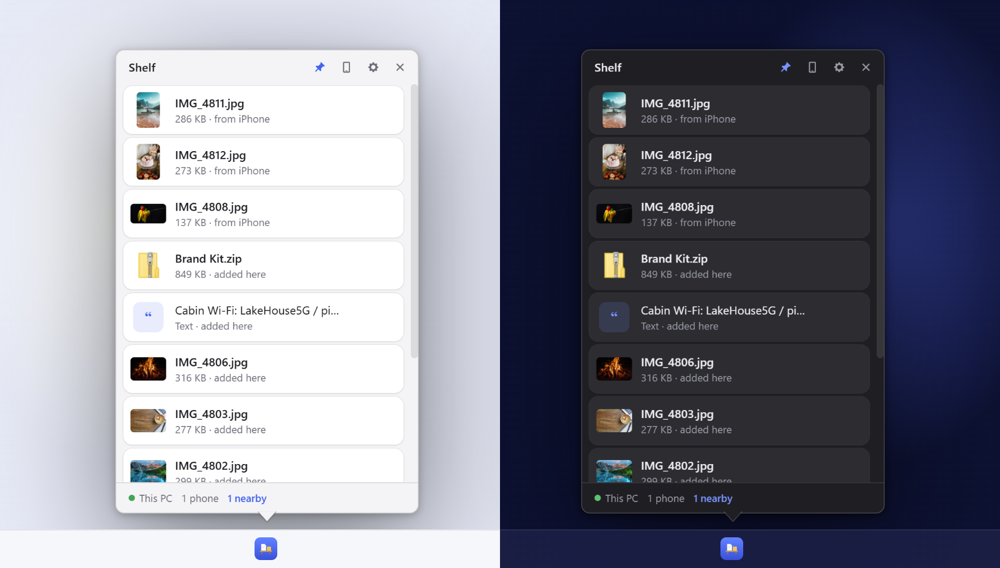
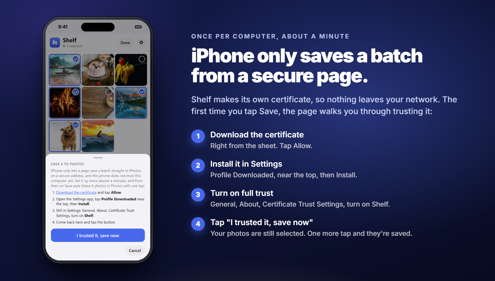

<p align="center"></p>

# Shelf

I built Shelf to move files between my PC, my Mac and my iPhone without emailing them to
myself.

It's a shelf that every one of your devices shares. Drop a file on it on one computer and
it shows up on every other computer on your Wi-Fi, ready to drag out. Open it on your phone
and the same stuff is there, and you can save a whole batch of photos straight to your
camera roll. Things you take off the shelf clear themselves after a few minutes, so it
never turns into a junk drawer.

It runs on Windows and macOS, and your phone just uses the browser. Files go straight from
one device to the other over your own network. No account, no cloud, nothing leaves your
house. It's free.

<p align="center"></p>

## Download

Grab the latest version from [Releases](https://github.com/barongartner/Shelf/releases/latest).

| Computer | File |
| --- | --- |
| Windows | `Shelf-Setup-<version>.exe` |
| Windows, no install | `Shelf-<version>-portable.exe` |
| Mac with Apple silicon (M1 and newer) | `Shelf-<version>-mac-arm64.zip` or `.dmg` |
| Mac with Intel | `Shelf-<version>-mac-x64.zip` or `.dmg` |

**Windows:** run the installer. When Windows Firewall asks, allow it and tick **Private
networks**. That's it.

**Mac:** the Mac builds aren't notarized by Apple, so macOS blocks the app the first time
you open it. The easy way around that is to install it from Terminal, which skips the block
completely. Apple silicon:

```bash
curl -fsSL https://api.github.com/repos/barongartner/Shelf/releases/latest | grep -o 'https://[^"]*-mac-arm64\.zip' | head -1 | xargs curl -fL -o /tmp/Shelf.zip && rm -rf /Applications/Shelf.app && ditto -x -k /tmp/Shelf.zip /Applications
```

Intel:

```bash
curl -fsSL https://api.github.com/repos/barongartner/Shelf/releases/latest | grep -o 'https://[^"]*-mac-x64\.zip' | head -1 | xargs curl -fL -o /tmp/Shelf.zip && rm -rf /Applications/Shelf.app && ditto -x -k /tmp/Shelf.zip /Applications
```

Then open Shelf from Applications. Run the same line again any time to update.

If you'd rather download the .dmg or .zip in Safari, open the app once, then go to System
Settings, Privacy & Security, scroll down to Security and click **Open Anyway**. On macOS
14 and older, right-click the app and choose Open. Either way, say yes when it asks to find
devices on your local network.

## Using it

Shelf lives in the menu bar on a Mac and in the tray on Windows. Click the icon and the
shelf pops up right at it. Click again to hide it. You can drag it somewhere else if you
want, and Settings has a button to snap it back.

- **Put stuff on it:** drag files or folders onto the shelf, or hit Ctrl+V / Cmd+V to paste
  text, an image or a copied file.
- **Take stuff off:** drag it out to your desktop, a folder or another app. You can also
  hit the download arrow to save it to Downloads, or double-click to open it.
- **It cleans up after itself:** once something's been taken, it stays on every shelf for
  10 minutes with a countdown, then it's gone. Hit **Keep** if you want it to stay.
- **Remove:** click the x. It's gone from every computer and phone.

Keyboard: Up/Down to pick, Space for Quick Look on a Mac, Enter to open, Delete to remove,
Esc to hide.

<p align="center"></p>

### Your phone

1. Click the phone button at the top of the shelf. You'll get a QR code.
2. Scan it with your phone's camera and open the link. The shelf opens in your browser.
   There's no app to install. No camera? Type the address under the code into your phone's
   browser and enter the six-digit code.
3. Add it to your Home Screen (Share, then Add to Home Screen). The page shows you how the
   first time. From then on it opens like an app, already signed in.

You only scan once. After that your phone stays connected and reconnects on its own every
time you open it. If your computer's asleep, the page tells you and picks back up when it
wakes. Scanning the code again on a phone that's already connected doesn't add it twice.

On the phone, photos and videos show as a grid and everything else as a list. Tap anything
to open it.

**Saving photos:** tap **Select**, pick as many as you want, and tap **Save**. The share
sheet comes up, you tap **Save Images**, and they're all in your camera roll. No zip files,
no Files app.

<p align="center"></p>

**The one-time setup:** iPhone only lets a website save to Photos from a secure page, so
the first time you tap Save, Shelf walks you through trusting your computer. It takes about
a minute:

1. Download the certificate and tap **Allow**.
2. Open Settings, tap **Profile Downloaded** near the top, and install it.
3. In Settings go to General, About, Certificate Trust Settings and turn on **Shelf**.
4. Go back to Shelf and tap **I trusted it, save now**. Your photos are still selected, so
   one more tap and they're saved.

You do this once per computer. If you added Shelf to your Home Screen before doing the
setup, delete that icon and add it again afterwards. Until you've done it, you can still
save one photo at a time by pressing and holding it.

<p align="center"></p>

**Notifications:** open Shelf from the Home Screen icon, go to Settings and tap **Turn on
notifications**. Now when something lands on the shelf from another device, your phone
pings you ("4 photos, sent from your PC"). Tap it and Shelf opens with them already picked
out, so photos are one tap from your camera roll. Stuff you send from the phone yourself
doesn't ping you. On iPhone this needs the one-time setup above and the Home Screen icon,
and the computer that sends them has to be on with Shelf running.

**Sending stuff from your phone:** use **Photos** and **Files** at the bottom of the page,
or paste text in. It shows up on every computer with your phone's name on it, and the
computers pop a notification so you know it's there (you can turn that off in Settings).

**The share sheet:** you can put Shelf in the share sheet of every app on your iPhone. Share
a link, a photo or a file, tap Shelf, and it's on the shelf without leaving the app you're
in. Links come through as links, even though Shortcuts hands over the whole web page. Apple
doesn't let websites in there, so it's a Shortcut. The steps to build it are in the phone's
Settings under **Share Sheet**, along with the address to paste (about two minutes). It sends
straight to your computer over your Wi-Fi, so your phone has to be on the same network.

If you have a Mac, you can make it a one-tap install instead. iPhone only adds Shortcuts
that Apple has signed, and only a Mac can sign them, so run this once on the Mac while
Shelf is running on your computer:

```bash
curl -fsSL http://<your-computer>.local:47474/shortcut/unsigned -o /tmp/Shelf.shortcut && shortcuts sign -m people-who-know-me -i /tmp/Shelf.shortcut -o ~/Desktop/Shelf.shortcut
```

Put the signed `Shelf.shortcut` in Shelf's data folder on the computer your phone uses
(`%APPDATA%\Shelf` on Windows, `~/Library/Application Support/Shelf` on a Mac). The phone's
Settings then shows **Install the Shortcut**. The signed file carries your Apple ID details,
which is why Shelf doesn't ship one.

**Other files:** the **Download** button saves to the Files app. Folders and multiple
non-photo files come down as a .zip.

### Connecting your computers

1. Install and open Shelf on each computer.
2. On the second one, open Settings (the gear). Your first computer shows up under
   **Nearby**. Click **Join**.
3. The first computer asks if it's okay. Click **Let It Join**.

Do the same for any other computers. Only computers you've let in can see or add to your
shelf.

Your phone works through any of them. If the computer your phone's connected to goes to
sleep, the page switches to another one by itself after about 15 seconds. You can also pick
one yourself under **Open through** in the phone's Settings.

Some guest and office networks block the automatic discovery. If your other computer never
shows up under Nearby, open **Other ways to connect** in Settings and type its IP address
(it's shown in that same section on the other computer).

### Settings

- The name this computer shows to the others
- How long taken stuff sticks around: 1, 5, 10, 30 or 60 minutes, or until you remove it.
  Each computer has its own setting, and the computer something was taken through decides.
- Pop the shelf open when something new arrives
- Keep the shelf on top of other windows (if this is off, it hides when you click away)
- Open Shelf when you log in
- Snap the shelf back next to its icon

## How it works

<p align="center"></p>

For the curious. Each computer runs a small server on port 47474 (and 47475 for the secure
phone page) and announces itself on your network over Bonjour/mDNS (`_shelf._tcp`). The
computers on a shelf swap their item lists whenever something changes, and every 10
seconds otherwise. Each one keeps its own copy of everything, so your stuff is still there
when the computer that added it goes to sleep.

Removing something is final. Once any computer removes it, it's gone everywhere. If
someone hits **Keep** while the computer that started the countdown is asleep, Keep wins.

Shelf never copies or moves your originals. When you drop a file on the shelf, it points at
the file where it already is, and removing it from the shelf never deletes your file.
Copies that come in from other devices live in Shelf's own app data folder and get deleted
when they leave the shelf.

Security: every request between your computers is signed with a secret made from your
shelf's code, and the secret itself never goes over the network. A device that just claims
to be on your shelf gets nothing. Each phone gets its own key when it scans the QR code,
and the computers only keep a hash of it. A phone that hasn't been seen in 90 days gets
dropped. Transfers between computers aren't encrypted, so use Shelf on networks you trust,
like your home Wi-Fi. The secure phone page uses a certificate each computer makes for
itself.

## Building it yourself

You need Node.js 22.12 or newer.

```bash
npm install
npm start            # run Shelf
npm run two          # run two copies on one computer, on the same shelf
npm test             # run the tests
npm run dist:mac     # unsigned .dmg/.zip in dist/
npm run dist:win     # installer and portable .exe in dist/
```

`SHELF_DEV=1 npm start` prints a pairing link so you can open the phone page in a browser
on the same computer, and serves the page straight from `src/web` so edits show up on
reload.

The README images are built from `media/source/Media.html`. Run
`npx electron media/source/render.js` to render them again.

Releases: bump `version` in package.json, tag `v<version>` and push the tag. GitHub Actions
builds the Windows files and ad-hoc signed Mac files and attaches them to the release.

## License

MIT. Do whatever you want with it.
